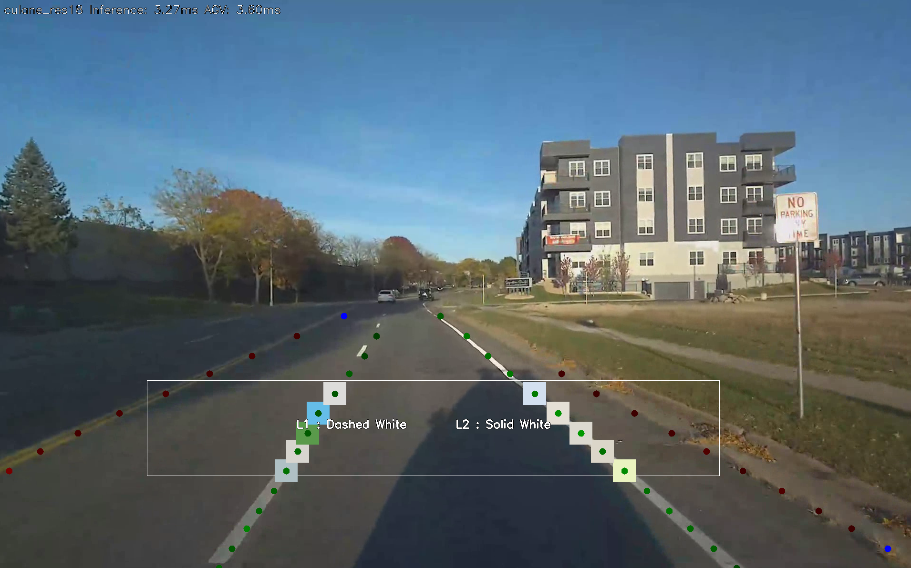

# Ultra Fast Lane Line Detection v1 implementation

####  Note: In any given frame -   Current Lane's IDs are 1 and 2.   lane to the left of lane 1  has ID 0  lane to the right of lane 2  has ID 3

## Instructions for getting UFLDv1 on a Jetson Container 
#### #### WIP; needs an update ####
* The process is similar as below, but instead of installing the dependencies, hop into the test-container, mount the repo as a volume, convert the weights, and run the scripts:
* Run the new docker container, attach to the UFLDv1 volume, and enter an interactive shell:
* `sudo docker run -it --name UFLD -v $(pwd)/UFLDv1:/UFLDv1 ufldv1`
* To renter container after creating volume, use `sudo docker run -it -v $(pwd)/UFLDv1:/UFLDv1 ufldv1`
* Convert the weights as above if necessary

## Instructions for getting UFLDv1 on the workstation

### Create Conda Environment
* `conda create -n UFLDv1`
* `conda activate UFLDv1`

### Install Dependencies
* Install [nvidia tensorrt 10](https://docs.nvidia.com/deeplearning/tensorrt/install-guide/index.html#installing)
* `conda install opencv`
* `pip install nvidia-pyindex`
* `pip install nvidia-tensorrt`
* `conda install -c conda-forge cuda-python`
* `conda install -c conda-forge pycuda`

### Convert .onnx to .engine file on your system
* Download .onnx weights from [Google Drive](https://drive.google.com/drive/folders/1EMz-5pp7Nyon23D00V6efW1pYq4O5plL?usp=drive_link)
* Clone VisionCore from GitHub and navigate to [Ultra-Fast-Lane-Detection-v1](/lane-lines/Ultra-Fast-Lane-Detection-v1/)
* Open a terminal, navigate to the repo, and then run `mkdir weights`
* Move .onnx file to weights directory
* `export PATH=$PATH:/usr/src/tensorrt/bin`
* `trtexec --onnx=weights/ultra_falst_lane_detection_culane_288x800.onnx --saveEngine=weights/culane_res18.engine`

### Add Common.py Symlink
* `sudo ln -s /usr/src/tensorrt/samples/python/common.py common.py`

### Example Visualization

* For only visualizing lane detection with classification:
`python3 old_scripts/trt_classify_visualize_lane.py --model ./weights/culane_res18.engine --model_config culane --videopath <~/path/to/your/video_file>`  

##### Current Lanes in Green with adjacent lanes marked in Red   The darker the dot, the lower it's confidence. The dots marked in blue have a confidence of < 0.1

## Run the Deployment Script
#### Classification with Depth laneline points, TensorRT 10 (Live Camera Stream)
* `python lanelines.py --ip_address <127.0.0.1:30000 is the default for ZED X> --debug_mode <0 is default, use 1 for visualization>`

#### Classification with Depth laneline points, TensorRT 10 (SVO Input)
* `python svo_lanelines.py --input_svo_file <path/to/svo2_file>`

## Other Dev Scripts Measurment
#### Print depth from camera to lane points, TensorRT 10 (SVO Input)
* `python old_scripts/trt_print_depth_lane.py --model weights/culane_res18.engine  --input_svo_file <path/to/svo2_file> --resolution HD1200`
#### Print depth from camera to fixed point (Live Camera Input)
* `python old_scripts/distance2point.py --resolution SVGA`
####  Print depth from camera to fixed point (SVO Input)
* `python old_scripts/distance2point.py --input_svo_file <path/to/svo2_file> --resolution SVGA`

