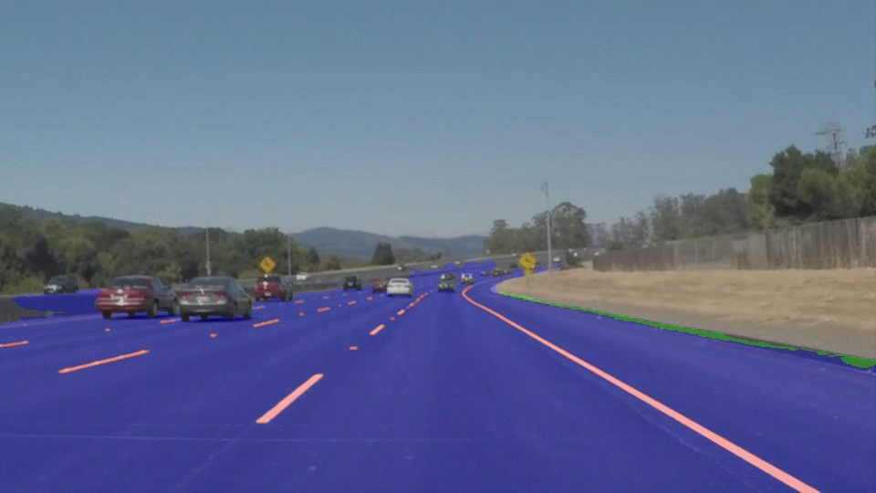

### ENV Setup
- __Install ZED SDK before proceeding__

- __Activate the same env as that required by [UltraFastLaneDetectionv1](../Ultra-Fast-Lane-Detection-v1/README.md)__

    - __Alternatively, use the following to setup a new env__
        ```
        conda env create -f conda_base.yml
        conda activate ll
        pip install -r piprequirements.txt
        python /usr/local/zed/get_python_api.py 
        ```

### Alternative container setup on Linux
- __Install Docker and Docker Compose__
 
-  __Go to root of VisionCore__
 
- __Connect X11 to container__
`xhost +local:docker` 

- __Build with Docker Compose__
`docker compose up -d --build`

- __Connect to container__ 
`docker exec -it zed_container /bin/bash` 


- __Note if your NVIDIA drivers are very new you may need to downgrade to version 580 or older__


### Download weights (old)
- __Download the onnx weights from [Google Drive](https://drive.google.com/drive/folders/1aZSu0DcASy3urAZhN1oQRlLh3QMqcXp6?usp=drive_link)__

- __Convert onnx to trtexec__
`trtexec --onnx=weights/model_float32.onnx --saveEngine=weights/lane_segmentation.engine`

### Downloads weight (TwinLiteNet)
- __Get the models__
`https://drive.google.com/drive/folders/1EqBzUw0b17aEumZmWYrGZmbx_XJqU-vz` 

- __Convert pytorch to onnx__
```
python3 pytorch_to_onnx.py
``` 
- __Convert onnx to engine__
`python3 convert_to_engine.py` 


### Start stream
- __Before running either model you need to go to VisionCore/camera-streaming and start a camera stream__


### Inference (old)


- __Run script using:__
 ```
 python lanesegmentation.py --debug_mode 1
 ```

 

### Inference (TwinLiteNet)

- __Run script using:__
```
python3 lanesegmentation_TwinLite_trt.py
``` 


### Common Errors
- **If you encounter GLIBCXX version error in conda env, try the following:**
    ```
    find /usr -name "libstdc++.so.6" 2>/dev/null
    strings /usr/lib/x86_64-linux-gnu/libstdc++.so.6 | grep GLIBCXX_3.4.30
    ```

    - if you find the missing verison eg: `GLIBCXX_3.4.30`

    - Try: `LD_PRELOAD=/usr/lib/x86_64-linux-gnu/libstdc++.so.6 python lanesegmentation.py --debug_mode 1`

    - if that worked, make it permanent using 
    ```
    mkdir -p $CONDA_PREFIX/etc/conda/activate.d
    echo 'export LD_PRELOAD=/usr/lib/x86_64-linux-gnu/libstdc++.so.6' > $CONDA_PREFIX/etc/conda/activate.d/ld_preload.sh
    chmod +x $CONDA_PREFIX/etc/conda/activate.d/ld_preload.sh
    ```

